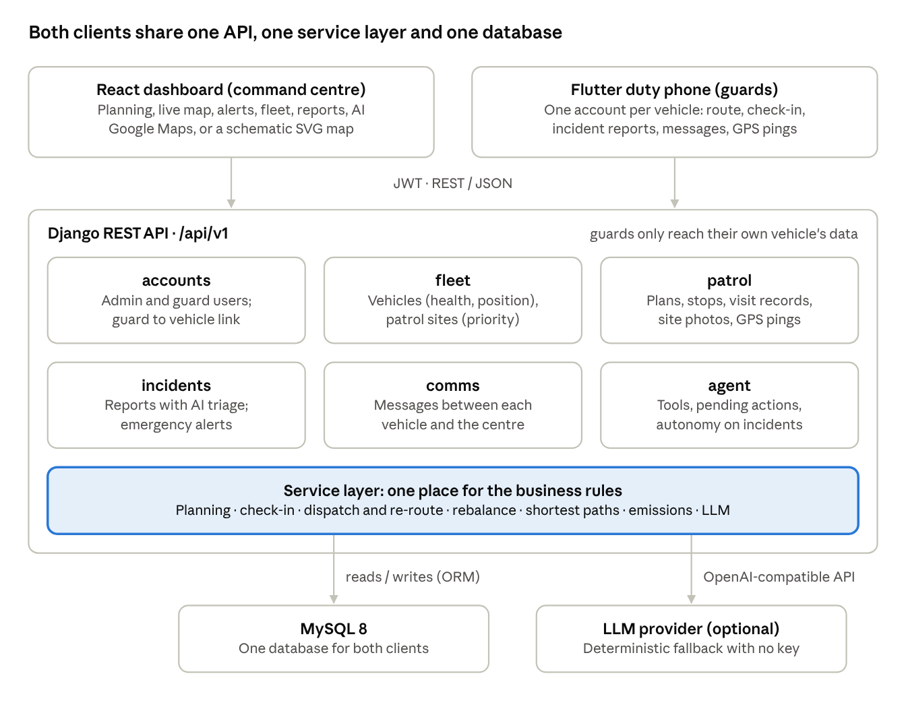

# Dynamic Patrol Routing System — Project Report

Huang Jiashu · 10 October 2026

## Abstract

The Dynamic Patrol Routing System automates the nightly route planning of a security patrol fleet and cuts the mileage driven, and therefore the carbon emitted, by about 55% against manual planning on the demo data (105 km versus 232 km a night).

Today, command-centre administrators plan routes for roughly 50 sites and 5 vehicles by hand, collect proof-of-visit photos over WhatsApp, and send vehicles back to their original route after every emergency. The system replaces this with three parts: a Django REST backend with a priority-aware multi-vehicle route planner and a dynamic re-router, a React command-centre dashboard, and a Flutter app on each vehicle's duty phone. When an emergency alarm diverts a vehicle, its remaining stops are re-planned from the emergency site instead of driving back, and the saving is recorded. An optional AI agent lets operators run the system in plain language, with every action it proposes held for human confirmation.

## Problem statement

Night patrols are planned by hand, recorded over WhatsApp and disrupted by emergencies in a way that wastes fuel, and none of this scales as the business grows.

The client, a security service provider, patrols about 50 sites across Singapore every night with 5 vehicles. How many vehicles can actually drive depends on their health: a vehicle that breaks down or is in maintenance leaves the rest of the fleet to cover its sites.

The current process has five problems:

1. **Manual planning.** Every night, administrators in the command centre decide which sites each driver visits. This is manageable at 50 sites and 5 vehicles, but it grows with every new contract and depends on the administrators' judgement rather than on distance.
2. **Proof of visit is scattered.** Guards photograph each site and send the pictures over WhatsApp. Photos are easily lost and cannot be searched or reported on.
3. **Emergencies cause backtracking.** When an alarm goes off, the nearest vehicle is told to go there. Afterwards it drives back to the site where it left its route and carries on, which costs extra time and fuel.
4. **No visibility.** The command centre has no single view of where vehicles are, which ones are fit to drive, or what the patrol costs in mileage and emissions.
5. **Carbon emissions.** One US gallon of petrol emits about 8,887 g of CO2. Every unnecessary kilometre adds to the company's footprint, against the global goal of net-zero emissions by 2050.

Formally, this is a vehicle routing problem that is **static and stochastic**: the sites are known in advance, but emergencies arise at random sites during the night and force changes to routes already under way.

## Project objectives

The project has two high-level targets: reduce carbon emissions, measured by the difference in mileage between the original and the proposed routes, and remove the need for administrators to plan routes every night.

These break down into four objectives from the problem definition:

1. **Daily automatic planning.** Plan each vehicle's route every day from the sites and the vehicles available that day, covering every site with the shortest overall distance.
2. **Dynamic re-planning.** Automatically re-plan the route of a vehicle diverted to an emergency, so it does not drive extra kilometres back to its old route.
3. **Command-centre dashboard.** Show real-time vehicle locations, vehicle details (plate number, driver in charge, health status, mileage), an emergency alert noticeboard and the estimated carbon footprint.
4. **Mobile app.** Let the guards in each vehicle view the night's route plan and contact the command centre directly.

## Requirements

Every requirement in the problem definition and the design draft is implemented. The table maps each one to the part of the system that delivers it.

| Area | Requirement | Implemented by |
| --- | --- | --- |
| Planning | Daily plan from available vehicles and sites, every site covered, shortest total distance | Multi-vehicle planner; `plan_daily` command; one-click Automatic plan |
| Planning | Shortest path with Dijkstra, Bellman-Ford and Floyd-Warshall | Routing service; Shortest path tool on the dashboard |
| Planning | Re-plan a vehicle diverted to an emergency | Emergency dispatch with dynamic re-routing |
| Planning | Vehicles unavailable because of their health status | Vehicles in service or out of service are excluded; Rebalance moves a broken-down vehicle's sites |
| Planning | Manual route planning | Route Planning, Manual plan tab |
| Carbon | Estimate emissions from mileage and engine type | Emissions service (kg CO2e per km by engine type) |
| Carbon | Compare original and proposed routes; graph past emissions per vehicle | Manual baseline stored per plan; per-vehicle 30-day chart; carbon-savings panel |
| Dashboard | Add or remove locations and vehicles | Locations, Vehicles and Guards pages |
| Dashboard | Real-time vehicle location on Google Maps | Live Map, fed by duty-phone GPS pings |
| Dashboard | Vehicle details: plate, contact, driver in charge, health status, mileage | Fleet status table and Vehicles page |
| Dashboard | Emergency alert noticeboard | Dashboard noticeboard and Emergency Alerts page |
| Dashboard | Past patrol records; daily or monthly report | Patrol Records (with photos); Reports with CSV export |
| Mobile | Each account linked to one vehicle | Guard profile's assigned vehicle; all mobile endpoints scoped to it |
| Mobile | View the route plan and next location | Route screen with navigation to the next site |
| Mobile | Submit pictures of the location | Check-in with camera or gallery photos, stored centrally |
| Mobile | Submit an incident report | Incident screen with photos and AI triage |
| Mobile | Contact the command centre by message or phone | Command screen: message thread and Call button |
| Data | Central MySQL database for vehicles, locations, daily plans and guard images | MySQL 8 (SQLite for local development) |

## Solution overview and architecture

The solution is one backend serving two clients: a web dashboard for the command centre and a mobile app for each vehicle, both reading and writing the same central database.



Every business rule (planning, check-in, dispatch, re-routing, rebalancing) lives in one service layer, which the API, the AI agent, the nightly command and the demo seeder all call. A rule therefore behaves the same no matter who triggers it.

**Data model.** The main entities follow the design draft: users with an admin or guard role; a guard profile with badge, availability, on-duty and driver flags and its linked vehicle; vehicles with plate, model, engine type, odometer, health status, availability and last known position; sites with coordinates, priority and an emergency flag. A plan holds ordered stops per vehicle, its total and baseline distance and emissions, and its re-route savings. Visits are stored as patrol records with their photos; GPS pings, incident reports, emergency alerts and messages complete the model.

**Roles.** Administrators have full access. Guards can only read their own vehicle's stops, records, pings and messages and their own incident reports, and cannot reach planning, fleet management, dashboards or the agent.

## Route planning and dynamic re-routing

The planner covers every site exactly once, visits higher-priority sites first and minimises total distance; the re-router continues from the emergency site rather than going back. Both are pure Python with no external map service, so they are fast, testable and free to run.

### Road-network model

Sites are joined into an approximate road network rather than a complete graph. Each site is linked to its 5 nearest neighbours, and a minimum spanning tree (Prim's algorithm) is added so the network is always connected. Each edge weighs the great-circle (haversine) distance multiplied by a road-circuity factor of 1.3, since urban roads typically run 20–40% longer than a straight line.

Because the graph is sparse, a trip between two far-apart sites passes through intermediate sites. This makes the shortest-path algorithms meaningful: on a complete graph, the direct edge would always be the answer. Every active site is always part of the network, so the distance from A to B is the same in a daily plan, a manual plan and a re-route.

### Shortest-path algorithms

All three algorithms named in the proposal are implemented, and any of them can build the all-pairs distance matrix the planner uses:

- **Dijkstra** with a binary heap, O((V + E) log V) per source.
- **Bellman-Ford**, O(V·E) per source, which also detects negative cycles.
- **Floyd-Warshall**, O(V³) for all pairs at once.

Tests confirm they produce identical matrices, and the dashboard's Shortest path tool runs all three on the same query and shows each one's distance and run time.

### Daily multi-vehicle planner

The planner implements the proposal's `shortestRoute(location_list, priority_location, num_car)` as a capacitated, priority-aware multi-vehicle travelling-salesman heuristic:

1. Build the distance matrix with the chosen algorithm.
2. Give each vehicle one of the highest-priority sites as a seed.
3. Insert the remaining sites one by one at the position that adds the least distance, capping each vehicle at ceil(n / vehicles) + 1 stops so the work is shared fairly.
4. Re-order each route tier by tier: emergency sites first, then high and normal priority. Each tier is built with nearest-neighbour and improved with 2-opt.
5. Move single sites between vehicles while doing so shortens the total, then re-optimise each route.

Only operational vehicles are planned: those marked available and not in service or out of service. Vehicles can start from a shared depot or from their live GPS positions. The `plan_daily` command runs this nightly from cron, so no administrator input is needed.

### Dynamic re-routing after an emergency

When an alarm is raised at a site, the command centre (or the AI agent, with confirmation) dispatches the nearest operational vehicle. The re-router then:

1. Sends the vehicle from its current position to the emergency site.
2. Re-optimises its remaining unvisited stops starting **from the emergency site**.
3. Removes the emergency site from any other vehicle's remaining route, so it is not visited twice.
4. Costs the old practice for comparison: drive to the emergency, back to the last site visited, then resume the original order.
5. Stores the difference in km and kg CO2e on the alert and the plan, and messages the vehicle's duty phone.

When a vehicle breaks down mid-patrol, **Rebalance** inserts its unvisited sites into the remaining routes of the other vehicles, each at its cheapest position.

## Carbon emission estimation

Emissions are estimated from the two factors the design draft names, mileage and engine type, and every saving is measured as kilometres not driven.

```math
\text{CO}_2\text{e (kg)} = \text{distance (km)} \times f_{\text{engine}}
```

| Engine type | Factor (kg CO2e per km) | Basis |
| --- | --- | --- |
| Petrol | 0.192 | 8,887 g CO2 per US gallon (2.35 kg per litre) at about 8.2 L per 100 km; matches the US EPA typical passenger vehicle |
| Diesel | 0.171 | Fleet average |
| Hybrid | 0.106 | Fleet average |
| Electric | 0.050 | Grid-average upstream emissions, not zero |

The factors live in one module so they are easy to tune.

Savings come from two sources:

- **Planning.** Each plan stores a *manual baseline* next to the optimised route: the same sites handed out round-robin in priority order and visited in that order, with no distance optimisation. This stands in for planning by hand. Saved CO2e is the baseline's emissions minus the plan's, per vehicle and engine type.
- **Re-routing.** Each emergency dispatch stores the km and CO2e saved against driving back to the original route.

The dashboard and reports show both, and the system can also compare a shortest-distance plan with a best-traffic plan (modelled as 12% longer but with 6% lower emissions per km from smoother driving), as the design draft asks.

## Command-centre dashboard

The React dashboard gives administrators one place to see the night's patrol, act on emergencies and manage the fleet; it is restricted to admin accounts.

| Page | What administrators do there |
| --- | --- |
| Dashboard | KPIs (operational vehicles, sites patrolled, active alerts, CO2e emitted and saved), the emergency noticeboard, a live map of vehicles and routes, the fleet status table, per-vehicle emissions over 30 days and a carbon-savings panel |
| Live Map | Vehicle positions and each vehicle's remaining route, refreshed every 5 s; sites with an active alarm pulse red |
| Route Planning | Automatic plan (vehicles, sites, algorithm, depot or live start), Manual plan (stop order per vehicle), plan history with Rebalance, and the shortest-path comparison of the three algorithms |
| Emergency Alerts | Raise an alert, dispatch the nearest or a chosen vehicle, see the new route against the old practice with km and CO2e saved, and resolve |
| Incidents | AI-triaged reports from guards with photos; acknowledge or resolve |
| Messages | One conversation per vehicle with unread counts |
| Vehicles, Locations, Guards | Add, edit and remove; link guard accounts to vehicles; trigger a site alarm |
| Patrol Records | Past visits filtered by vehicle and date, with the site photos |
| Reports | Daily or monthly totals, per-vehicle distance and emissions, carbon savings, an AI-written summary and CSV download |
| AI Assistant | Chat with the agent and confirm or reject the actions it proposes |

Maps use Google Maps when an API key is configured. Without one, a schematic SVG map projects the same sites, vehicles and routes, so the dashboard works out of the box.

## Duty-phone mobile app

The Flutter app runs on the phone in each vehicle. Each guard account is linked to one vehicle, and the server scopes every request to that vehicle, so the app never sends a vehicle id and a guard cannot see another vehicle's data.

- **Route.** Shows the night's plan, progress and the next location, with a Navigate button that opens Google Maps directions. It refreshes every 30 s and warns the driver when the command centre re-routes them to an emergency.
- **Check in.** Marks a site visited with camera or gallery photos and notes. The photos are stored centrally against the visit, replacing WhatsApp.
- **Incident.** Sends a description, the site and photos, and shows the AI's severity, category and recommended action straight away.
- **Command.** A message thread with the command centre and a Call button that dials the command-centre hotline.
- **On duty.** A switch that posts the phone's GPS position every 15 s, which drives the dashboard's live map.

The app talks to the same REST API as the dashboard, using JWT tokens that refresh automatically. The design draft suggested Firestore for mobile data; using the shared API and MySQL database instead keeps one source of truth for both clients.

## AI agent and incident triage

AI is used in two places, and in both a human stays in control: the agent proposes, an operator confirms.

**Incident triage.** When a guard submits a report, a language model (with vision for photos) classifies it into a fixed schema: category, severity (low to critical), summary, recommended action and an anomaly flag. Model output is checked against that schema before it is stored.

**Agent ("Sentinel").** Operators can run the system in plain language, for example "plan tonight's patrol" or "handle the active emergency alerts". The agent calls the same service layer as the dashboard through about a dozen tools:

- **Read tools** run immediately: fleet, sites, live positions, routes, alerts, incidents, shortest paths, emissions and reports.
- **Write tools** never run directly: creating a plan, raising or dispatching an alert and changing an incident's status are queued as pending actions for an operator to confirm or reject. Every tool call and its result is stored for audit.

**Autonomy.** When an incident is triaged as high or critical at a known site, the system raises an emergency alert and the agent queues a dispatch of the nearest operational vehicle, including the re-route, for the operator to confirm.

The model provider is configurable (any OpenAI-compatible API). With no API key, deterministic fallbacks take over (keyword-based triage, and a keyword router for the agent in English and Chinese), so the whole system can be demonstrated offline.

## Technology stack

The stack follows the design draft (Django, MySQL, React, Flutter) and adds only what the features need.

| Layer | Technology | Why |
| --- | --- | --- |
| Backend framework | Python, Django 4.2, Django REST Framework | Mature ORM and admin; one API serves both the dashboard and the app |
| Authentication | JWT (SimpleJWT) with refresh-token rotation | Stateless tokens suit a mobile client; roles separate admins and guards |
| API documentation | drf-spectacular (OpenAPI 3, Swagger UI) | Always-current contract for the mobile app |
| Database | MySQL 8 (PyMySQL driver); SQLite for development | Central store required by the proposal; SQLite for zero-setup runs |
| Algorithms | Pure Python: haversine, Prim's MST, Dijkstra, Bellman-Ford, Floyd-Warshall, insertion and 2-opt heuristics | No paid routing API; fully unit-testable |
| Dashboard | React 18, Material UI, MUI Data Grid, Nivo charts | Component library for data-heavy admin pages |
| Maps | Google Maps JavaScript API (`@react-google-maps/api`), SVG fallback | Live tracking as specified; works without a key |
| Mobile app | Flutter (Dart) with http, geolocator, image_picker, url_launcher, shared_preferences | One codebase for Android and iOS; GPS, camera, maps and phone calls |
| AI | OpenAI-compatible chat and vision models via the `openai` SDK, with offline fallback | Provider-agnostic; demoable without a key |
| Deployment | Docker Compose (MySQL, Gunicorn web, dashboard), environment-based settings | Same setup on any machine |
| Quality | Django test runner, GitHub Actions CI (backend tests, schema check, dashboard build, Flutter analyze and test) | Every push is checked |

## Testing and evaluation

Automated planning cut nightly mileage by 55% against the manual baseline on the demo data, and all automated tests pass.

### Tests

| Suite | Count | Covers |
| --- | --- | --- |
| Backend (Django) | 58 tests | Algorithm correctness and agreement, planner coverage, balance and priority order, re-route never worse than driving back, emissions, every API flow, role-based access |
| Dashboard | Production build with warnings treated as errors | All 12 pages also opened in a headless browser with no console errors |
| Mobile (Flutter) | Static analysis plus 2 tests | Sign-in screen; parsing of the route payload |

### Results

Measured on the seeded Singapore demo (20 sites, 4 operational vehicles) and on 50 randomly placed sites across Singapore with 5 vehicles:

| Scenario | Optimised route | Manual baseline | Saving |
| --- | --- | --- | --- |
| Demo night, 20 sites, 4 vehicles | 105.2 km | 232.3 km | 127.1 km (55%), 18.3 kg CO2e |
| Random 50 sites, 5 vehicles | 359 km | 1,009 km | 650 km (64%) |
| Emergency diversion (demo) | 35.6 km | 48.1 km driving back | 12.5 km |

The 50-site plan was computed in about 10 ms. Building the all-pairs matrix for 50 sites took 4 ms with Dijkstra, 15 ms with Bellman-Ford and 9 ms with Floyd-Warshall, and all three gave the same distances. A re-route saves nothing when the vehicle's last visited site already lies on the shortest road path; the system reports 0 km in that case rather than an estimate.

The baseline is a stand-in for manual planning, not data from the client's actual routes, so the real-world saving should be confirmed against recorded mileage.

## Limitations and future work

The main limits come from approximating the road network and from validating on demo data rather than live operations.

- **Road distances are approximate.** The nearest-neighbour network with a 1.3 circuity factor stands in for real roads. A road-network source such as OpenStreetMap or a distance-matrix API would give true driving distances and travel times, and would make the best-traffic comparison real rather than modelled.
- **Heuristic, not optimal.** Multi-vehicle routing is NP-hard; insertion plus 2-opt and relocation gives good routes quickly but not proven optima. Metaheuristics from the literature (genetic algorithms, ant colony, tabu search) or an integer-programming solver could be benchmarked against it.
- **No time windows or shift limits.** Plans balance the number of stops, not driving time, and do not model site opening hours or a maximum shift length.
- **Emission factors are averages.** Per-vehicle fuel consumption from telematics would make the estimates specific to each vehicle.
- **Validation.** The manual baseline should be compared with the client's recorded routes, and the Flutter app still needs testing on physical Android and iOS devices.
- **Notifications.** The duty phone polls for re-routes and messages; push notifications (for example Firebase Cloud Messaging) would deliver emergencies instantly.

## Conclusion

The Dynamic Patrol Routing System meets all four objectives of the problem definition. Nightly routes are planned automatically from the vehicles fit to drive, covering every site with priority sites first. Vehicles diverted to an emergency carry on from the emergency site instead of driving back. The command centre has live tracking, vehicle details, an emergency noticeboard and a carbon view. Guards plan, check in, report and contact the command centre from one app.

On the demo data, the system cuts nightly mileage and CO2e by about 55% against manual planning and removes the nightly planning task altogether. The next steps are real road distances and validation against the client's recorded routes.
