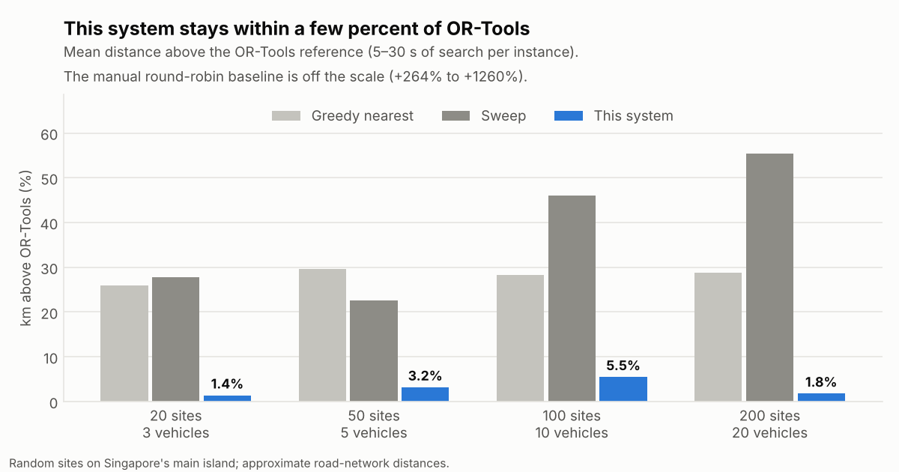
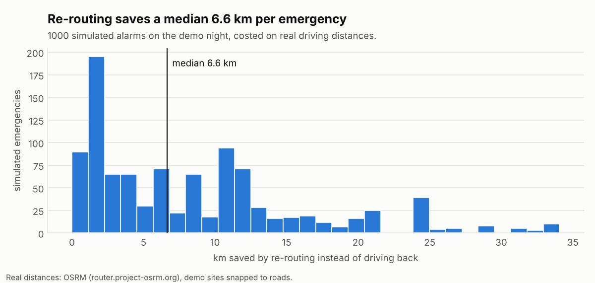
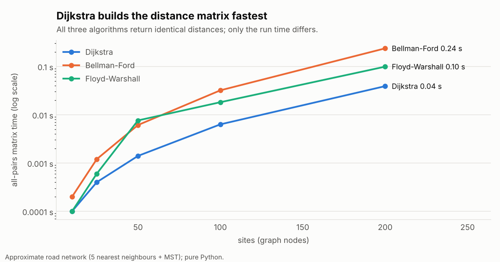
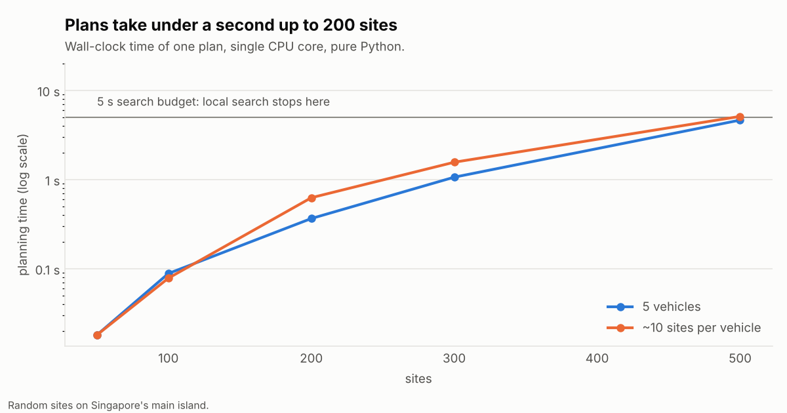
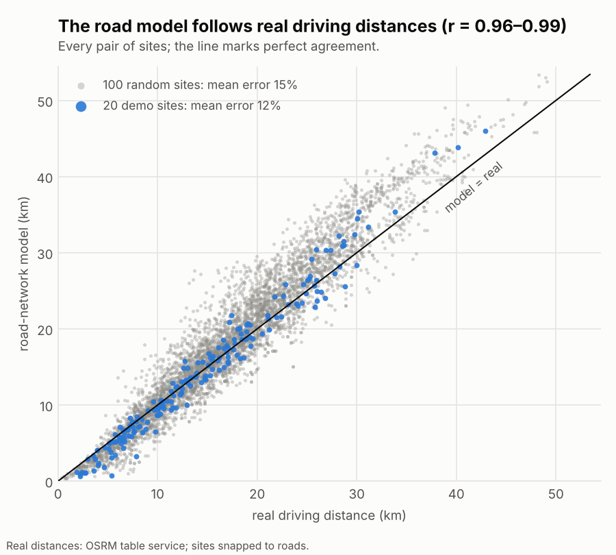

# Evaluation results

Generated by `python -m evaluation.run` on 2026-11-20 (Python 3.13.18).
Methodology and discussion: [`docs/PROJECT_REPORT.md`](../PROJECT_REPORT.md#testing-and-evaluation).

## E1 Planning quality

Total km per night, mean over random instances, and the mean gap to the OR-Tools reference on the same instance (negative = shorter than OR-Tools). Every method covers every site with the same balance cap. OR-Tools ran guided local search for 5, 10, 20 and 30 s at 20, 50, 100 and 200 sites.

| Sites | Vehicles | Method | Instances | Mean km | vs OR-Tools (%) | Instances shorter than OR-Tools | Mean time (s) |
| --- | --- | --- | --- | --- | --- | --- | --- |
| 20 | 3 | Manual (round-robin) | 10 | 271.8 | 263.7 | 0 | 0.0 |
| 20 | 3 | Greedy nearest | 10 | 94.3 | 25.9 | 0 | 0.0 |
| 20 | 3 | Sweep | 10 | 95.2 | 27.7 | 0 | 0.0 |
| 20 | 3 | This system | 10 | 76.0 | 1.4 | 0 | 0.003 |
| 20 | 3 | OR-Tools (reference) | 10 | 74.9 | 0.0 | 0 | 5.007 |
| 50 | 5 | Manual (round-robin) | 10 | 800.9 | 532.0 | 0 | 0.0 |
| 50 | 5 | Greedy nearest | 10 | 164.3 | 29.7 | 0 | 0.0 |
| 50 | 5 | Sweep | 10 | 155.3 | 22.6 | 0 | 0.0 |
| 50 | 5 | This system | 10 | 130.8 | 3.2 | 1 | 0.023 |
| 50 | 5 | OR-Tools (reference) | 10 | 126.7 | 0.0 | 0 | 10.001 |
| 100 | 10 | Manual (round-robin) | 5 | 1772.1 | 911.1 | 0 | 0.0 |
| 100 | 10 | Greedy nearest | 5 | 224.6 | 28.2 | 0 | 0.002 |
| 100 | 10 | Sweep | 5 | 256.2 | 46.0 | 0 | 0.0 |
| 100 | 10 | This system | 5 | 185.2 | 5.5 | 1 | 0.121 |
| 100 | 10 | OR-Tools (reference) | 5 | 175.5 | 0.0 | 0 | 20.002 |
| 200 | 20 | Manual (round-robin) | 3 | 3461.6 | 1260.5 | 0 | 0.0 |
| 200 | 20 | Greedy nearest | 3 | 328.7 | 28.7 | 0 | 0.01 |
| 200 | 20 | Sweep | 3 | 395.9 | 55.4 | 0 | 0.001 |
| 200 | 20 | This system | 3 | 259.6 | 1.8 | 2 | 0.611 |
| 200 | 20 | OR-Tools (reference) | 3 | 255.3 | 0.0 | 0 | 30.002 |

## E2 Dynamic re-routing

Random alarms during a planned night: drive back to the last visited site and resume (old practice) versus continue from the emergency site with the rest of the route re-optimised.

| Scenario | Trials | Mean saved (km) | Median (km) | 90th pct (km) | Alarms with a saving (%) | Saving vs drive-back (%) |
| --- | --- | --- | --- | --- | --- | --- |
| demo night, road model | 1000 | 13.66 | 11.28 | 27.14 | 100.0 | 25.9 |
| demo night, real roads | 1000 | 8.51 | 6.64 | 20.03 | 95.7 | 17.7 |
| 50 random sites, road model | 1000 | 4.68 | 2.62 | 12.36 | 81.5 | 8.4 |

## E3 Shortest-path algorithms

| Sites | Algorithm | All-pairs time (s) | Same distances as Dijkstra |
| --- | --- | --- | --- |
| 10 | dijkstra | 0.0001 | True |
| 10 | bellman_ford | 0.0002 | True |
| 10 | floyd_warshall | 0.0001 | True |
| 25 | dijkstra | 0.0004 | True |
| 25 | bellman_ford | 0.0012 | True |
| 25 | floyd_warshall | 0.0006 | True |
| 50 | dijkstra | 0.0014 | True |
| 50 | bellman_ford | 0.0061 | True |
| 50 | floyd_warshall | 0.0076 | True |
| 100 | dijkstra | 0.0063 | True |
| 100 | bellman_ford | 0.0319 | True |
| 100 | floyd_warshall | 0.0181 | True |
| 200 | dijkstra | 0.0389 | True |
| 200 | bellman_ford | 0.2357 | True |
| 200 | floyd_warshall | 0.0986 | True |

## E4 Scalability

| Sites | Vehicles | Planning time (s) | Total km |
| --- | --- | --- | --- |
| 50 | 5 | 0.018 | 127.6 |
| 50 | 5 | 0.018 | 127.6 |
| 100 | 5 | 0.088 | 205.3 |
| 100 | 10 | 0.078 | 186.0 |
| 200 | 5 | 0.364 | 305.2 |
| 200 | 20 | 0.623 | 259.8 |
| 300 | 5 | 1.059 | 384.7 |
| 300 | 30 | 1.558 | 328.4 |
| 500 | 5 | 4.626 | 488.3 |
| 500 | 50 | 5.088 | 417.6 |

## E5 Road model against real roads

Every pair of sites, real driving distances from OSRM. Error = mean absolute percentage error.

| Instance | Pairs | Real ÷ straight line (median) | Straight line error (%) | Straight × 1.3 error (%) | Road model error (%) | Road model correlation |
| --- | --- | --- | --- | --- | --- | --- |
| demo_20 | 190 | 1.365 | 29.5 | 11.6 | 11.8 | 0.987 |
| random_100 | 4949 | 1.447 | 32.6 | 14.0 | 15.0 | 0.96 |

### The demo night costed on real roads

| Plan | Model km | Real-road km |
| --- | --- | --- |
| Manual round-robin | 232.2 | 228.0 |
| This system, planned on the model | 102.2 | 117.8 |
| This system, planned on real distances | – | 109.9 |

On real roads, the plan made on the model is 48% shorter than the manual baseline.
